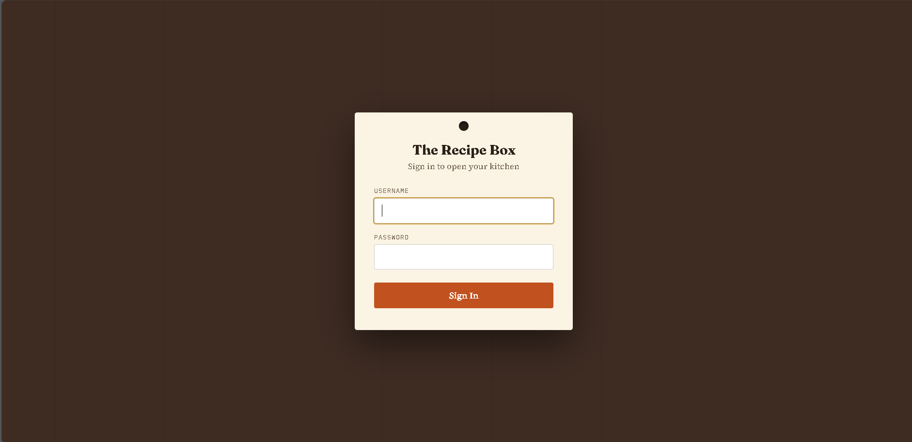
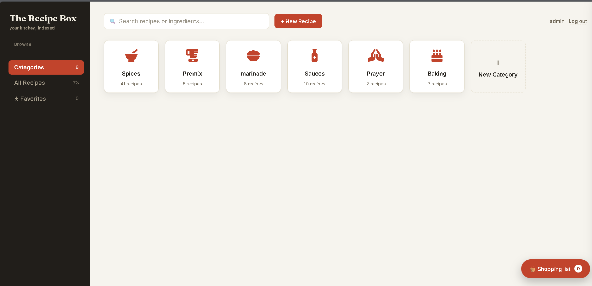
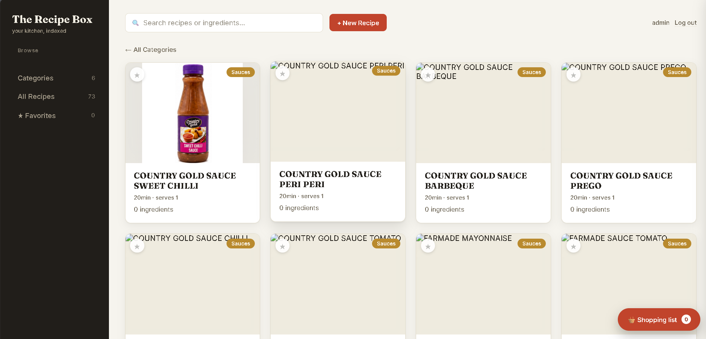
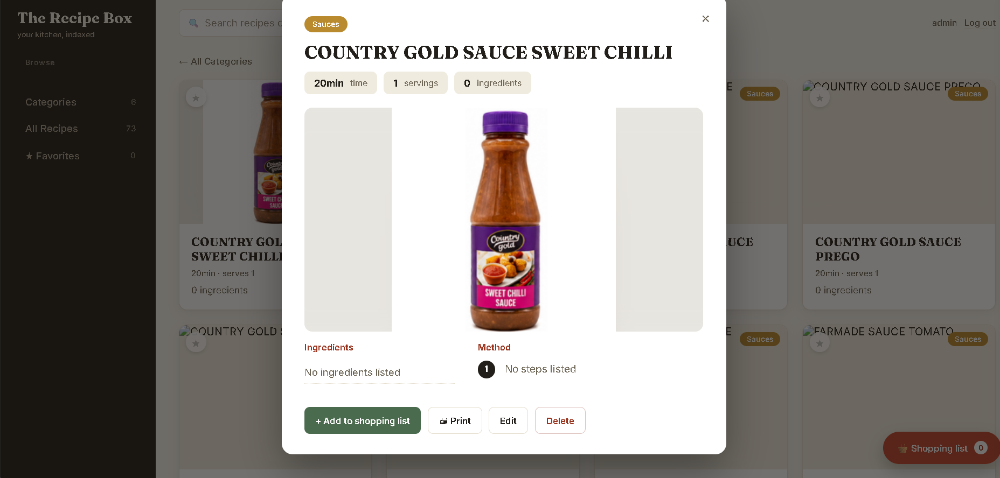
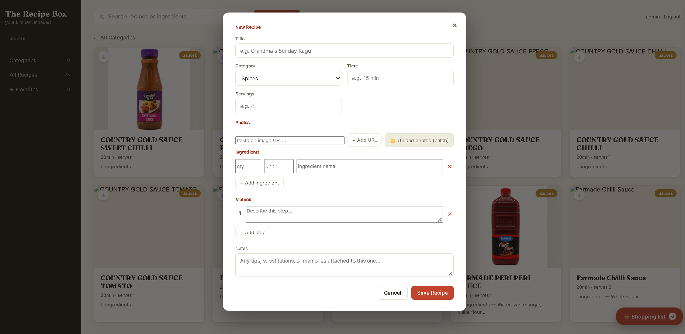

# Recipes Management System

A web-based recipe management application developed using PHP, MySQL, HTML, CSS and JavaScript.

## About the Project

This project demonstrates my practical web development skills through the development of a recipe management platform.

## Technologies Used

- PHP
- MySQL
- HTML5
- CSS3
- JavaScript
- XAMPP

## Key Features

- Recipe management
- Database integration
- Dynamic web pages
- Responsive user interface
- Server-side functionality

## Installation

1. Install XAMPP.
2. Clone or download this repository.
3. Place the project folder inside `htdocs`.
4. Start Apache and MySQL.
5. Import the project database using phpMyAdmin, if required.
6. Configure the database connection.
7. Open `http://localhost/recipes/` in your browser.

## Developer

**GitHub:** [BlvckJoke](https://github.com/BlvckJoke)

## Screenshots

### Login

### Dashboard

### Recipe Listing

### Recipe Details

### New Recipe

